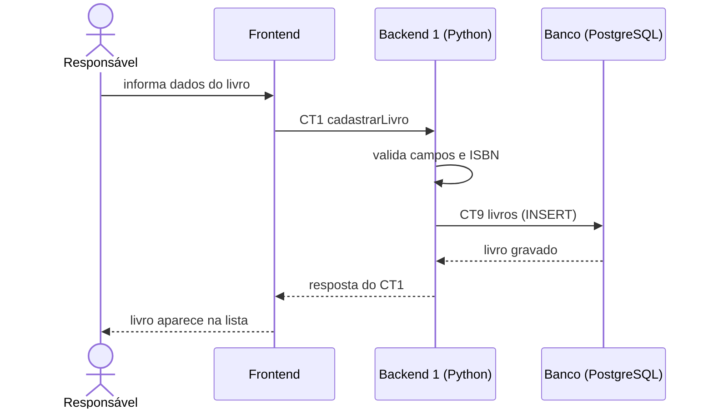

# Fluxo do E1: Cadastro de livros

**Resultado esperado:** O responsável cadastra um livro com título, autor, ISBN e quantidade de exemplares, e o livro aparece na lista.

## Passos

1. O responsável preenche título, autor, ISBN e quantidade de exemplares no Frontend.
2. O Frontend chama o Backend 1 com a operação cadastrarLivro (CT1).
3. O Backend 1 valida os campos e verifica se o ISBN ainda não foi cadastrado.
4. O Backend 1 grava o livro na tabela livros (CT9), inicializando quantidadeDisponivel com a quantidade de exemplares.
5. O Backend 1 responde ao Frontend com o livro criado (CT1).
6. O Frontend inclui o livro na lista exibida ao responsável.

## Diagrama de sequência

## Contratos usados

CT1 cadastrarLivro, CT9 livros.
