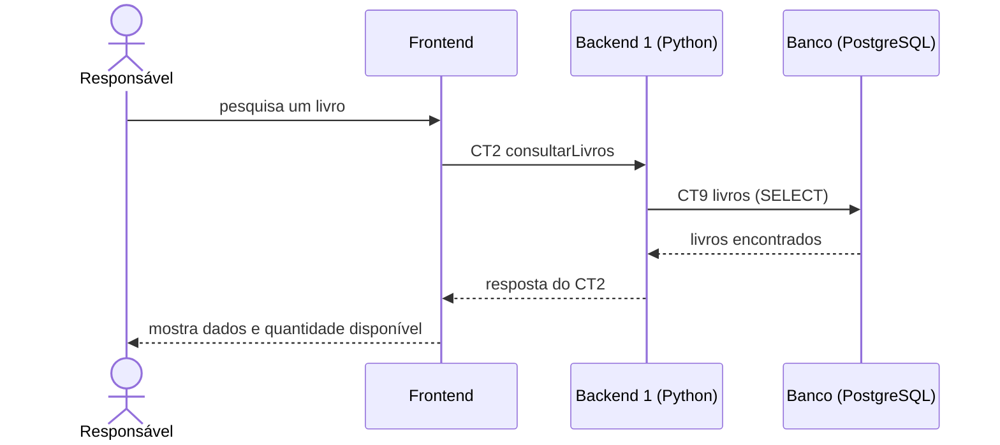

# Fluxo do E2: Consulta de livros

**Resultado esperado:** O responsável pesquisa um livro e visualiza seus dados e a quantidade disponível.

## Passos

1. O responsável informa um termo de pesquisa no Frontend.
2. O Frontend chama o Backend 1 com consultarLivros (CT2).
3. O Backend 1 consulta a tabela livros usando o termo informado (CT9).
4. O Banco devolve os livros encontrados e suas quantidades.
5. O Backend 1 responde ao Frontend com a lista paginada (CT2).
6. O Frontend mostra título, autor, ISBN e quantidade disponível.

## Diagrama de sequência

## Contratos usados

CT2 consultarLivros, CT9 livros.
