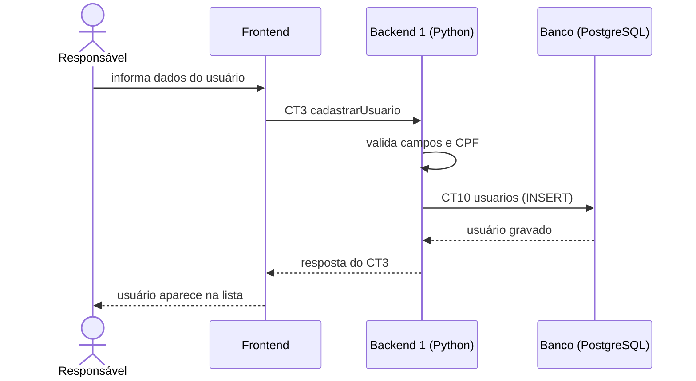

# Fluxo do E3: Cadastro de usuários

**Resultado esperado:** O responsável cadastra um usuário com nome, CPF e contato, e ele aparece na lista.

## Passos

1. O responsável preenche nome, CPF e contato no Frontend.
2. O Frontend chama o Backend 1 com cadastrarUsuario (CT3).
3. O Backend 1 valida os campos e verifica se o CPF ainda não existe.
4. O Backend 1 grava o usuário na tabela usuarios (CT10).
5. O Backend 1 responde ao Frontend com o usuário criado (CT3).
6. O Frontend mostra o usuário na lista.

## Diagrama de sequência

## Contratos usados

CT3 cadastrarUsuario, CT10 usuarios.
