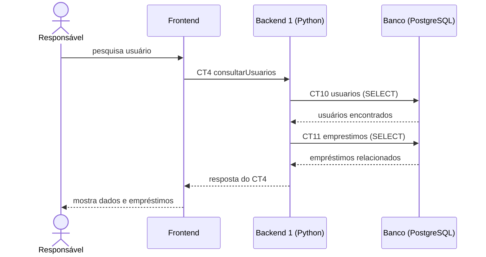

# Fluxo do E4: Consulta de usuários

**Resultado esperado:** O responsável pesquisa um usuário e visualiza seus dados e empréstimos.

## Passos

1. O responsável informa nome ou CPF no Frontend.
2. O Frontend chama o Backend 1 com consultarUsuarios (CT4).
3. O Backend 1 consulta os dados na tabela usuarios (CT10).
4. O Backend 1 consulta os empréstimos relacionados na tabela emprestimos (CT11).
5. O Backend 1 responde ao Frontend com os dados e empréstimos do usuário (CT4).
6. O Frontend apresenta o resultado ao responsável.

## Diagrama de sequência

## Contratos usados

CT4 consultarUsuarios, CT10 usuarios, CT11 emprestimos.
