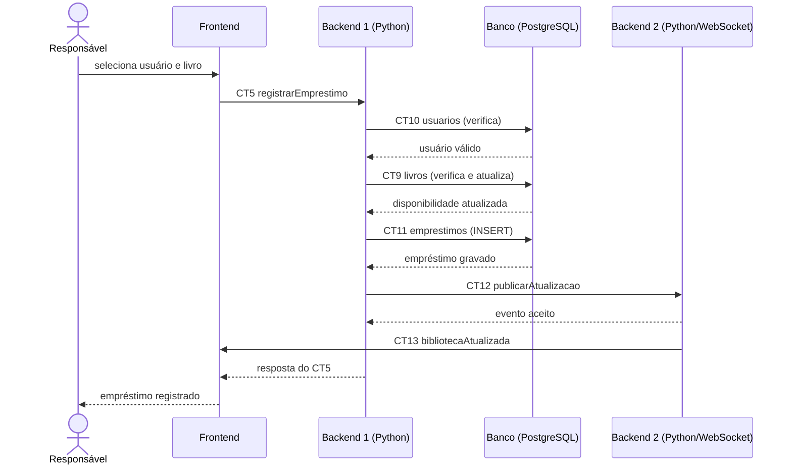

# Fluxo do E5: Registro de empréstimo

**Resultado esperado:** O responsável seleciona um usuário e um livro disponível, e o empréstimo é registrado no sistema.

## Passos

1. O responsável seleciona um usuário e um livro com exemplares disponíveis no Frontend.
2. O Frontend chama o Backend 1 com registrarEmprestimo (CT5).
3. O Backend 1 valida o usuário e o livro e confirma a disponibilidade.
4. O Backend 1 define dataLimiteDevolucao para 15 dias depois do empréstimo.
5. O Backend 1 grava o empréstimo na tabela emprestimos (CT11) e reduz quantidadeDisponivel na tabela livros (CT9).
6. O Backend 1 publica a atualização no Backend 2 (CT12).
7. O Backend 2 distribui bibliotecaAtualizada às telas abertas (CT13).
8. O Backend 1 responde ao Frontend com o empréstimo registrado (CT5).
9. O Frontend mostra o empréstimo e a nova disponibilidade.

## Diagrama de sequência

## Contratos usados

CT5 registrarEmprestimo, CT9 livros, CT10 usuarios, CT11 emprestimos, CT12 publicarAtualizacao, CT13 bibliotecaAtualizada.
