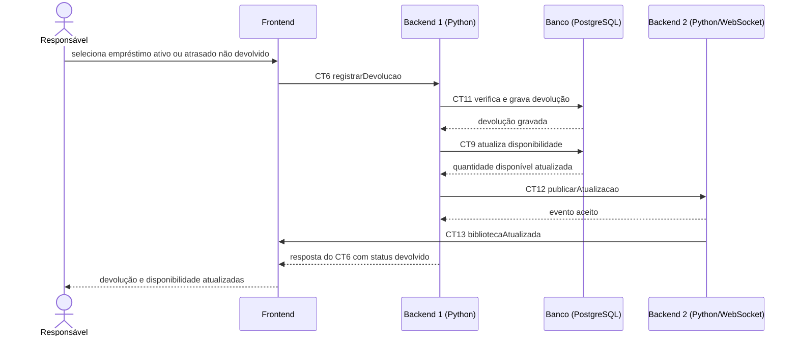

# Fluxo do E6: Registro de devolução

**Resultado esperado:** O responsável registra a devolução de um livro e o exemplar volta a ficar disponível.

## Passos

1. O responsável seleciona no Frontend um empréstimo com situação efetiva `ativo` ou `atrasado` e sem devolução registrada.
2. O Frontend chama o Backend 1 com `registrarDevolucao` (CT6).
3. O Backend 1 verifica se o empréstimo existe e se ainda não foi devolvido (`devolvidoEm` vazio). A situação `atrasado` não impede a devolução.
4. O Backend 1 registra `devolvidoEm`, grava o status `devolvido` na tabela `emprestimos` (CT11) e aumenta `quantidadeDisponivel` na tabela `livros` (CT9).
5. O Backend 1 publica a atualização no Backend 2 (CT12).
6. O Backend 2 envia `bibliotecaAtualizada` às telas abertas (CT13).
7. O Backend 1 responde ao Frontend com a devolução registrada e o status `devolvido` (CT6).
8. O Frontend mostra o empréstimo como devolvido e o exemplar como disponível.

A situação efetiva `atrasado` é calculada conforme CT8 quando o prazo passou e não há devolução registrada. Ela não impede a operação CT6; após uma devolução bem-sucedida, a situação passa a `devolvido`.

## Diagrama de sequência

## Contratos usados

CT6 `registrarDevolucao`, CT9 `livros`, CT11 `emprestimos`, CT12 `publicarAtualizacao` e CT13 `bibliotecaAtualizada`.
