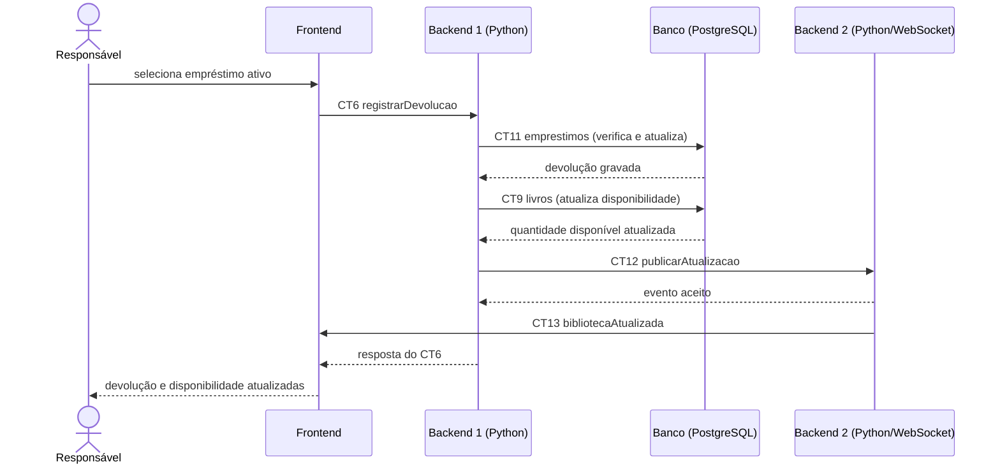

# Fluxo do E6: Registro de devolução

**Resultado esperado:** O responsável registra a devolução de um livro e o exemplar volta a ficar disponível.

## Passos

1. O responsável seleciona um empréstimo ativo no Frontend.
2. O Frontend chama o Backend 1 com registrarDevolucao (CT6).
3. O Backend 1 verifica se o empréstimo existe e ainda está ativo.
4. O Backend 1 atualiza o empréstimo na tabela emprestimos (CT11) e aumenta quantidadeDisponivel na tabela livros (CT9).
5. O Backend 1 publica a atualização no Backend 2 (CT12).
6. O Backend 2 envia bibliotecaAtualizada às telas abertas (CT13).
7. O Backend 1 responde ao Frontend com a devolução registrada (CT6).
8. O Frontend mostra o empréstimo como devolvido e o exemplar como disponível.

## Diagrama de sequência

## Contratos usados

CT6 registrarDevolucao, CT9 livros, CT11 emprestimos, CT12 publicarAtualizacao, CT13 bibliotecaAtualizada.
