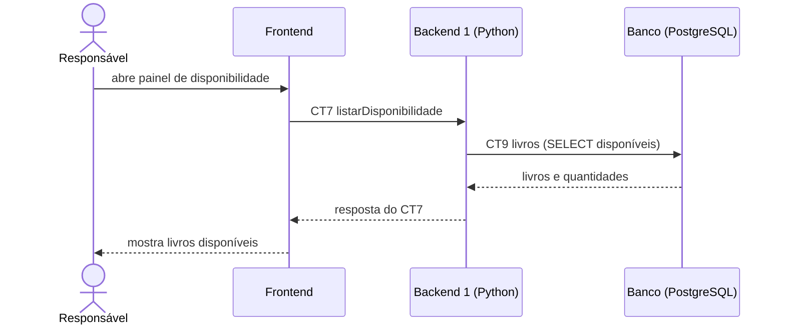

# Fluxo do E7: Controle de disponibilidade

**Resultado esperado:** O sistema apresenta quais livros possuem exemplares disponíveis para empréstimo.

## Passos

1. O responsável abre o painel de disponibilidade no Frontend.
2. O Frontend chama o Backend 1 com listarDisponibilidade (CT7).
3. O Backend 1 consulta a tabela livros (CT9) filtrando quantidadeDisponivel maior que zero.
4. O Banco devolve os livros e as quantidades disponíveis.
5. O Backend 1 responde ao Frontend com a lista de disponibilidade (CT7).
6. O Frontend marca quais livros podem ser emprestados.

## Diagrama de sequência

## Contratos usados

CT7 listarDisponibilidade, CT9 livros.
