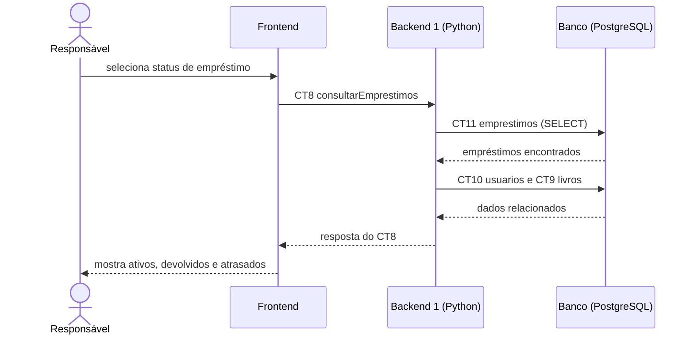

# Fluxo do E8: Consulta de empréstimos

**Resultado esperado:** O responsável visualiza os empréstimos ativos, devolvidos e atrasados.

## Passos

1. O responsável abre a consulta de empréstimos e escolhe, opcionalmente, um status.
2. O Frontend chama o Backend 1 com consultarEmprestimos (CT8).
3. O Backend 1 consulta os empréstimos na tabela emprestimos (CT11).
4. O Backend 1 consulta usuários e livros relacionados nas tabelas usuarios e livros (CT10 e CT9).
5. O Backend 1 responde ao Frontend com a lista classificada por status (CT8).
6. O Frontend mostra empréstimos ativos, devolvidos e atrasados.

## Diagrama de sequência

## Contratos usados

CT8 consultarEmprestimos, CT9 livros, CT10 usuarios, CT11 emprestimos.
