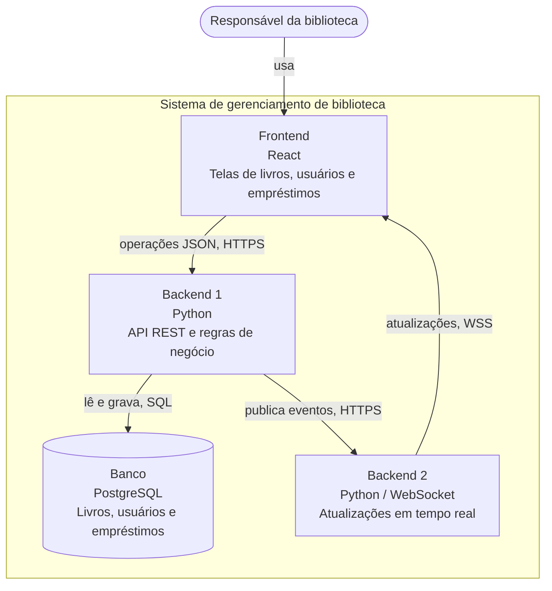

# Visão geral do sistema

Este projeto é um sistema simples para ajudar uma biblioteca a controlar livros, usuários e empréstimos sem depender de planilhas.

## Como o sistema foi dividido

| Módulo | O que faz | Tecnologia | Repositório | Responsável |
|---|---|---|---|---|
| Frontend | Telas para cadastrar e consultar livros e usuários, registrar empréstimos/devoluções e acompanhar disponibilidade | React | [pi4-0101-g5-frontend](https://github.com/ElVictron/pi4-0101-g5-frontend) | Gabriel Gregorio Ribeiro Leite |
| Backend 1 | API, regras de negócio e coordenação das operações do sistema | Python | [pi4-0101-g5-backend-1](https://github.com/ElVictron/pi4-0101-g5-backend-1) | Lucas Joaquim de Souza |
| Banco | Guarda livros, usuários e empréstimos | PostgreSQL | junto do Backend 1 | Lucas Joaquim de Souza |
| Backend 2 | Recebe eventos do Backend 1 e distribui atualizações em tempo real às telas abertas | Python / WebSocket | [pi4-0101-g5-backend-2](https://github.com/ElVictron/pi4-0101-g5-backend-2) | Victor Hugo Gulino dos Santos |

> **Decisão do grupo:** Gabriel fica responsável pelo Frontend. Lucas cuida do backend principal em Python e do banco. Victor cuida do segundo backend em Python, responsável por enviar as atualizações em tempo real. A comunicação entre os serviços será protegida por HTTPS; para atualizações em tempo real, será usado WSS.

## Diagrama de contêineres

## Convenção de nomes

Nas mensagens JSON entre módulos usamos **camelCase** (`livroId`, `quantidadeDisponivel`, `emprestadoEm`). No PostgreSQL usamos **snake_case** (`livro_id`, `quantidade_disponivel`, `emprestado_em`). Os status possíveis são `ativo`, `devolvido` e `atrasado`.

## Escopo e rastreabilidade

O escopo da Entrega 1 foi mantido. A próxima seção detalha os oito pontos: cadastro e consulta de livros, cadastro e consulta de usuários, empréstimo, devolução, disponibilidade e consulta de empréstimos.

## Fronteiras

- Frontend → Backend 1: HTTPS/JSON para as operações do sistema.
- Backend 1 → Banco: SQL sobre PostgreSQL.
- Backend 1 → Backend 2: HTTPS/JSON para publicar eventos.
- Backend 2 → Frontend: WSS/JSON para atualizações em tempo real.
